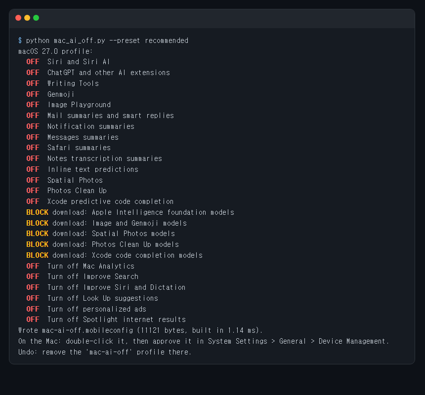
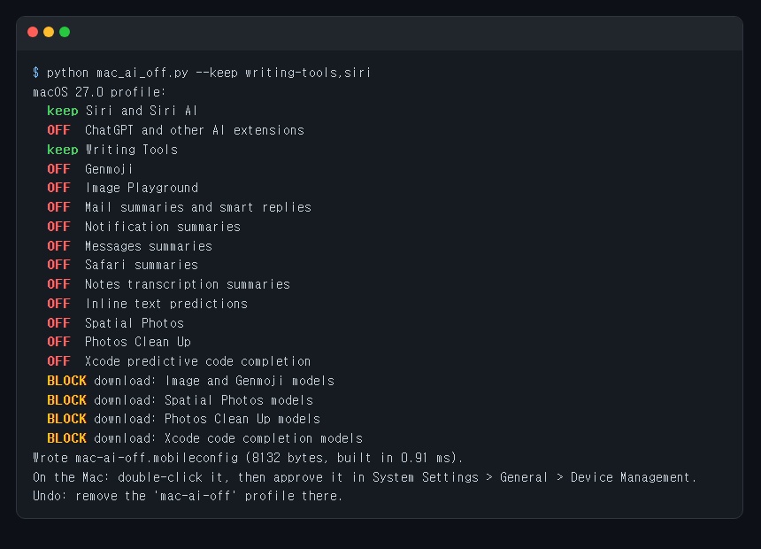
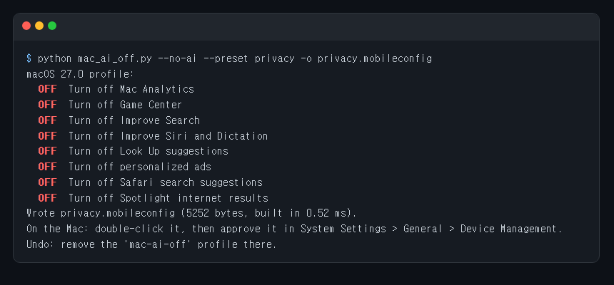

<div align="center">

# mac-ai-off

**Turn off Apple Intelligence on your Mac with one file you double-click. Remove it to undo.**

The configuration profile behind [RemoveMacAI](https://github.com/omlahore/RemoveMacAI) (5k+ stars, covered by The Verge and Ars Technica), as a 230-line Python script and three ready-made profiles. No app to install, nothing unsigned to run on your Mac.

Works with **Claude Code** and **Codex**.

 



<sub>Real output of <code>python mac_ai_off.py --preset recommended</code>, captured from the terminal.</sub>

</div>

## Quick start

No Python needed: download a ready-made profile and double-click it on your Mac.

| File | What it turns off |
|------|-------------------|
| [`profiles/apple-intelligence-off.mobileconfig`](profiles/apple-intelligence-off.mobileconfig) | All 14 Apple Intelligence features, and blocks their 5 model downloads |
| [`profiles/apple-intelligence-off-recommended.mobileconfig`](profiles/apple-intelligence-off-recommended.mobileconfig) | The above, plus Mac Analytics, personalized ads, Improve Siri, Improve Search, Spotlight web results and Look Up suggestions |
| [`profiles/privacy-only.mobileconfig`](profiles/privacy-only.mobileconfig) | Leaves Apple Intelligence alone. The six privacy settings above, plus Safari search suggestions and Game Center |

Then open **System Settings > General > Device Management**, select the profile and click **Install**.
To undo everything, select it there and click **Remove**.

To build your own (keep some features, pick other settings):

```bash
git clone https://github.com/Dodai0419/mac-ai-off && cd mac-ai-off
python mac_ai_off.py --keep writing-tools,siri --preset recommended
```
```
macOS 27.0 profile:
  keep Siri and Siri AI
  OFF  ChatGPT and other AI extensions
  keep Writing Tools
  OFF  Genmoji
  ...
Wrote mac-ai-off.mobileconfig (10043 bytes, built in 1.33 ms).
```
Python 3.8 or newer, standard library only. You can build the file on any computer (Windows, Linux, Mac) and AirDrop or email it to the Mac.

## Gallery

**Keep the parts you use.** `--keep writing-tools,siri` leaves those two on. It still blocks Image and Genmoji, Spatial Photos, Clean Up and Xcode models, and keeps the foundation models, because Siri and Writing Tools need them:



**Privacy only.** `--no-ai --preset privacy` leaves Apple Intelligence untouched and only locks the privacy settings:



**Older macOS.** `--macos 15.1` skips features that version does not have (ChatGPT arrived in 15.2, Notes summaries in 15.3, Safari summaries in 15.4, Spatial Photos in 26), so the profile never sets keys the system ignores.

**List everything:** `python mac_ai_off.py --list` prints every feature and setting id.

## The problem
- Apple Intelligence downloads gigabytes of models and keeps re-enabling features after updates.
- Turning it off by hand means a dozen switches in five places in System Settings, and some have no switch at all.
- The popular fix is a 35,000-line app that is not notarized, so you have to tell macOS to "Open Anyway" before it can change your system.

## The solution
| Idea | Fixes |
|------|-------|
| **One configuration profile** with the same restriction keys and forced settings as RemoveMacAI | Locks every feature off in one step, and it survives updates |
| **Model download blocks** pointing the asset service at a closed local port (technique from [pared](https://github.com/4evy/pared)) | Removed models don't silently download again |
| **A plain XML file**, built by readable Python or downloaded ready-made | You can read every key before installing. macOS shows the profile for approval, and **Remove** undoes it all |

## What is inside the profile

| Feature (`--keep` id) | How it is turned off |
|---|---|
| Siri (`siri`) | `allowAssistant` = false, Siri status menu and "Hey Siri" forced off |
| ChatGPT (`chatgpt`) | `allowExternalIntelligenceIntegrations(SignIn)` = false |
| Writing Tools, Genmoji, Image Playground | `allowWritingTools`, `allowGenmoji`, `allowImagePlayground` = false |
| Mail (`mail`) | `allowMailSummary`, `allowMailSmartReplies` = false and Mail preferences forced |
| Notification, Messages summaries | `summarize_previews`, `messageSummarizationEnabled` forced off |
| Safari, Notes summaries | `allowSafariSummary`, `allowNotesTranscriptionSummary` = false |
| Inline predictions | `NSAutomaticInlinePredictionEnabled` forced off |
| Spatial Photos, Photos Clean Up, Xcode completion | their model downloads blocked (plus `LocallyDisabled` for Spatial Photos) |

## Use with Claude Code
```bash
/plugin marketplace add Dodai0419/mac-ai-off
/plugin install mac-ai-off@mac-ai-off
```
Then ask: *"Make me a profile that turns off Apple Intelligence but keeps Writing Tools."*

## Use with Codex (ChatGPT)
```bash
git clone https://github.com/Dodai0419/mac-ai-off && cp -r mac-ai-off/skills/* ~/.codex/skills/
```
Or copy `AGENTS.md` into your project root.

## Benchmarks

| | RemoveMacAI | mac-ai-off |
|-|-|-|
| build one profile (`--preset recommended`) | not measured (needs macOS + Swift) | 2.6 ms |
| lines of code, whole project (Swift/ObjC) | 5,958 | 230 (Python) |
| lines for catalog + profile (`Catalog.swift`, `Profile.swift`, `Tweaks.swift`) | 661 | 230 |
| files in repo | 87 | 16 |
| runtime dependencies | macOS 14+, the app or a Swift build | none to install the profile; Python 3 stdlib to build one |

Command: `python -m timeit -n 1000 -r 5 -s "import mac_ai_off as m" "m.dump(m.build(set(), m.preset('recommended')))"` → best of 5 = 2.6 ms per loop. Windows 11, Python 3.11.1. Upstream LOC from `git ls-files | grep -E '\.(swift|m|h)$' | xargs wc -l` at commit `afdac00`.

**Parity checks** (`python -m unittest`, 16 tests): the profile checks from RemoveMacAI's `SelfTest.swift` are ported one by one. Writing Tools and Siri are off. Every model set has a download block. Payload UUIDs are unique and byte-identical to the Swift version (SHA-1, version 5 bits). The marker records the features. A kept feature keeps its models. A tweak-only profile blocks no downloads.

## What it does not do
RemoveMacAI also deletes models already on disk, turns off background updaters, cleans storage and applies Finder/Dock tweaks with `defaults`. mac-ai-off does only the profile part. Models already downloaded stay until macOS removes them. The download block stops new ones.

## Inspired by
- [omlahore/RemoveMacAI](https://github.com/omlahore/RemoveMacAI): the feature catalog, restriction keys, forced preferences and profile layout (MIT)
- [4evy/pared](https://github.com/4evy/pared): first mapped the macOS 27 keys, model sets and the download block technique

## Roadmap
- [ ] iPhone and iPad profiles (Apple Configurator can install the same format)
- [ ] `--check` to read an installed profile on the Mac and say what is still on
- [ ] Optional `defaults` script for the Finder and Dock tweaks

## License
MIT. Catalog data adapted from RemoveMacAI, copyright (c) 2026 omlahore, MIT (see LICENSE).
